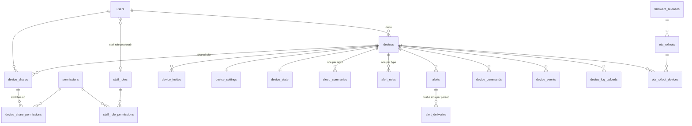

# Argus database design (v1.0)

**Status:** APPROVED by Devam on 3 Nov 2026, with decisions D1–D7 as recommended (see §10). D8 (serial meaning) is still open.
**SQL:** [`database/schema.sql`](../database/schema.sql). It was tested on a throwaway PostgreSQL 16, along with the checks listed in [§9](#9-how-the-schema-was-checked).
**Based on:** the UI mockup (`mockup/index.html`, 3 Nov 2026) and the Water Tank schema ([REFERENCE_NOTES.md §7](REFERENCE_NOTES.md#7-database)).

---

## 1. The big idea in five lines

1. **A device** is one ESP32-S3 with one DFRobot C1001 60 GHz radar. The factory registers it over USB, and a customer claims it by scanning its QR sticker.
2. **Live values are not saved.** Heart rate, breathing, movement, presence and sleep stage arrive about once a second. The backend keeps them in memory and pushes them to the browser. The mockup promises this: *"Live values … are not saved."*
3. **The saved health record is one sleep summary per device per night** (`sleep_summaries`). A summary is a few totals plus a hypnogram of 5-minute blocks.
4. **One permission system** for everyone:
   - The Argus team gets permissions **per role** (Owner, Developer, Manufacturing, Support, or a custom role).
   - Family members get permissions **per person, per sensor**.
5. **Everything else is copied from Water Tank:** login and tokens, the MQTT settings sync, commands, OTA and the audit log. Those parts already work in production.

## 2. Table map



There are 28 tables and 3 views, grouped below. The SQL has the full column list, with a comment on each column.

## 3. People and permissions

| Table | What it holds | Why |
|---|---|---|
| `users` | Everyone: customers, family and staff. Login is **phone + password**. | One account per phone number. A staff member who also owns a sensor needs only one login. |
| `staff_roles` | Owner, Developer, Manufacturing, Support, plus any role added on the Team screen | The mockup lets the Owner add roles and switch their permissions. |
| `staff_role_permissions` | Which staff permissions each role has | The Team → Roles table in the mockup. |
| `permissions` | The 15 permission codes, e.g. `history.view`, `firmware.rollout` | One list. Each code is either `staff` or `device`, and the database refuses to mix them up. |
| `device_shares` + `device_share_permissions` | Which family member can do what on which sensor | The Share access screen (one switch per person). |
| `device_invites`, `staff_invites` | Pending SMS invites | You can invite someone before they have an account. They join when they sign up with that phone number. |
| `refresh_tokens`, `otp_codes`, `push_tokens`, `user_notification_prefs` | Sessions, SMS codes, where to send push notifications, and the "How to reach me" settings | Same as Water Tank, plus the alert preferences. |

**How a permission is checked.** The backend asks one view, so the rules live in one place:

```sql
-- "May this user see sleep history for this sensor?"
SELECT 1 FROM device_user_permissions
 WHERE device_id = $1 AND user_id = $2 AND permission = 'history.view';
-- "May this staff member start an OTA rollout?"
SELECT 1 FROM staff_user_permissions WHERE user_id = $1 AND permission = 'firmware.rollout';
```

- The **device owner** automatically has all 5 device permissions.
- The **Owner role** automatically has all 10 staff permissions. It can't be edited and there is only one.

**Who is staff?** A user is staff when `users.staff_role_id` is set. That replaces Water Tank's fixed `super_admin | user` field.

## 4. Devices

| Table | What it holds | Notes |
|---|---|---|
| `devices` | Serial (`ARG-24A0012`), MAC, chip, hardware model, batch, date made, owner, name, room, disabled flag | One board per device, so Water Tank's `device_boards` table is dropped. The MQTT username is the MAC, as in Water Tank. |
| `device_settings` | Time zone, mounting position, detection range, night LED, auto-update | **Sent to the sensor.** Same versioned sync as Water Tank: change a setting → `version` goes up → the device acks → `applied_version`. The C1001 fields are placeholders until its parameter list is confirmed. |
| `settings_changes` | History of every settings change: who, old value, new value, when the device confirmed | Filled automatically by a trigger copied from Water Tank. |
| `device_state` | Online/offline, firmware, IP, Wi-Fi name and signal, uptime, last seen | **Connection health only. No health values.** This is what the device tables and the "Firmware in the field" chart read. |

**Name and room** stay in `devices`, not in `device_settings`. Only the app needs them; the sensor doesn't.

## 5. Sleep data (the important part)

**`sleep_summaries`** has one row per device per night. It holds everything shown on the Sleep history and Night screens:

- **Times:** got into bed / got out of bed, time in bed, total sleep, minutes to fall asleep, efficiency.
- **Stages:** minutes of deep, light, REM and awake.
- **Counts:** wake-ups, times out of bed, turn-overs.
- **Body:** average, lowest and highest heart rate and breathing rate.
- **Score:** 0–100.
- **`stages`:** the hypnogram as a list of numbers, one per 5-minute block: `0` awake, `1` REM, `2` light, `3` deep. A 7.5-hour night is 90 small numbers.
- **`raw`:** the exact JSON the sensor sent. If we later want a field we didn't add as a column, the data is already saved.

**`night_date`** is the local date the night **started**: "Sun 2 Nov" means the night of 2 → 3 November. The device's time zone decides this.

**Uploads can be retried safely.** Each device/night pair is unique, and the backend uses "insert, or update if it already exists". If the sensor sends the same night twice after a Wi-Fi drop, the row is replaced and never duplicated.

**Size:** about 1 KB per night. 1,000 sensors for a year is about 365,000 rows, roughly 0.4 GB. That's small for PostgreSQL.

**Removing a device deletes its sleep history.** The mockup says so on the Remove device card. This also means that if the sensor is resold and claimed by someone else, the new owner can't see the old owner's nights.

## 6. Alerts

| Table | What it holds |
|---|---|
| `alert_rules` | Per sensor, per type: on/off plus the numbers. The five mockup rules: breathing low (< 8 /min for 30 s), heart rate out of range (< 45 or > 110 bpm), out of bed at night (> 10 min between 23:00 and 06:00), no movement (3 h), sensor offline (15 min). The backend creates the default rows when the sensor is claimed. |
| `alerts` | One row each time a rule fires: what, the value, when it started and when it cleared. This is the "Recent" alerts list. |
| `alert_deliveries` | Who was told, by push or SMS, whether it worked, and when they read it. |

- **Rules belong to the sensor.** Everyone on that sensor shares the same rules, and editing them needs `settings.edit`, as the mockup shows.
- **How you are reached belongs to you** (`user_notification_prefs`: push, SMS, quiet hours).
- **No repeat spam.** The database allows only **one open alert per sensor per type**, so a breathing alert that stays low for an hour stays one alert.

## 7. Factory, commands, firmware, audit

| Table | What it holds |
|---|---|
| `device_commands` | `reboot`, `config_mode`, `ota_check`, `logs`: who sent it, its status, and the ack. Same flow as Water Tank. |
| `device_log_uploads` | The result of the `logs` command (the last 200 log lines). Capped at 64 KB. |
| `device_events` | Online/offline, reboot, radar fault, summary received, OTA results, claimed/unclaimed. |
| `firmware_releases` | Version, **channel (beta or stable)**, size, sha256, notes. |
| `ota_rollouts` + `ota_rollout_devices` | A rollout targets **all devices, a percentage, chosen serials, or devices on a given version**, with an install window (e.g. 10:00–18:00, so never during sleep). It can be paused. The chosen devices are fixed when the rollout starts. |
| `audit_log` | Every change by **staff and customers**. The database **refuses edits and deletes**; the mockup says "Entries cannot be edited." The person's name is copied into the row, so the log still reads correctly after an account is deleted. |
| `fleet_stats_hourly` | One row per hour for the dashboard chart "Devices online, last 24 h". |

## 8. What changed from Water Tank

| Kept as is | Changed | Dropped | New |
|---|---|---|---|
| UUID keys, UTC times, `set_updated_at`, hashed secrets, refresh tokens, OTP codes, push tokens, settings sync trigger, commands, events, OTA tables, audit log, `admin_stats` view | `users`: phone + password required, Google login removed, `staff_role_id` replaces `role`. `devices`: one board (MAC column on the device), adds batch / chip / room. `firmware_releases`: `channel` replaces `is_stable`. `ota_rollouts`: targets, install window, pause. `audit_log`: cannot be edited | `device_boards`, `pump_runs`, `timers`, pump enums, the tank columns in settings and state, the old `notifications` and `alert_settings` | `permissions`, `staff_roles`, `staff_role_permissions`, `device_share_permissions`, `staff_invites`, `sleep_summaries`, `alert_rules`, `alerts`, `alert_deliveries`, `user_notification_prefs`, `device_log_uploads`, `fleet_stats_hourly` |

**Clean-up job** (runs every 6 h, as in Water Tank):

| Data | Deleted after |
|---|---|
| Commands, alert deliveries | 1 year |
| Events, alerts | 2 years |
| Uploaded logs | 30 days |
| Hourly fleet stats | 90 days |
| Expired OTP codes, refresh tokens and invites | When they expire |
| Sleep summaries | Kept until the device is removed or the account is deleted (see D5) |

## 9. How the schema was checked

`schema.sql` ran without errors on a throwaway `postgres:16-alpine` container. A test script then confirmed:

- **Permissions:** the Owner role gets 10 staff permissions and Manufacturing gets 3. The device owner gets 5 device permissions, and the family member gets only the 2 that were switched on. Putting a staff permission on a family member is refused.
- **Settings sync:** changing the range from 1.5 to 2.5 m raises the version to 2 and logs the change. The device ack marks it applied.
- **Sleep summaries:** uploading the same night twice updates the row instead of duplicating it. A stage value of 4 is refused.
- **Alerts:** a second open alert of the same type is refused.
- **Audit log:** editing or deleting a row is refused. Deleting a user keeps their audit rows, with their name.
- **Other checks:** a bad serial is refused, and a percentage rollout without a percentage is refused.

## 10. Decisions (approved 3 Nov 2026)

| # | Question | Decision | Why it matters |
|---|---|---|---|
| **D1** | How does a sensor log in to MQTT? | **A per-device secret**, flashed at registration (`devices.secret_hash`). | Water Tank logs in with the MAC only. A MAC is not secret, so anyone who knows it could pretend to be that sensor and send fake vitals. For health data that matters more. |
| **D2** | Claim code and QR | Keep the mockup's **serial + code**, but make the code **12 characters** (`XXXX-XXXX-XXXX`) instead of 9. | 9 characters can be guessed with enough tries. 12 is far safer, together with the rate limit. |
| **D3** | Verify the phone number by SMS code at sign-up? | **Yes.** | Invites are matched by phone number. Without verification, someone could sign up with your mother's number and receive invites meant for her. It needs an SMS provider (msg91 is already wired up in the Water Tank code). |
| **D4** | Commands to an offline sensor | **Queue them for 24 h** (mockup behaviour), except `config_mode`, which should fail after 30 s. | Water Tank refuses with "device offline". The mockup says commands wait in a queue. Opening Wi-Fi setup hours later would surprise the customer. |
| **D5** | How long to keep sleep history? | **Until the device is removed or the account is deleted**, plus a "download my data" export later. | Health data: keep only what the customer expects. |
| **D6** | Who computes the sleep stages and score: the C1001/ESP32, or our backend? | **The device sends them.** We store them, plus the raw payload. | This depends on what the C1001 actually outputs. The columns are placeholders until we confirm. |
| **D7** | Who checks the alert rules? | **The backend**, using the live data stream (same pipeline as Water Tank's `live.js`). | This means the sensor must send live values every second, even when no one has the app open. A device-side check would save bandwidth but needs firmware work. |
| **D8** | Serial format | **OPEN.** `ARG-` + 7 characters, e.g. `ARG-24A0012`. What do `24A` and `0012` mean? (year, batch, running number?) | The database checks the format, and the factory screen generates the serials. |

---

### What the decisions change

| Decision | Effect |
|---|---|
| **D1** | `devices.secret_hash` is now required. At registration the backend creates a random secret, stores only its hash, and the Register page **writes the secret to the board over USB** (a serial provisioning command the firmware must support). The mockup's "Nothing is written to the board" text has to change. Mosquitto login becomes MAC + secret. |
| **D2** | The claim code is 12 characters from `23456789ABCDEFGHJKMNPQRSTVWXYZ`, shown as `XXXX-XXXX-XXXX`. The database stores only its HMAC, so the schema doesn't change. The mockup sample `7KQ-4MZ-2PX` and the "9 letters" hint need updating. |
| **D3** | Sign-up gets a step: an SMS code (`otp_codes`, purpose `verify_phone`). The backend refuses invites and claims until `users.phone_verified_at` is set. This needs an SMS provider account. |
| **D4** | The backend sets `device_commands.expires_at` to 24 h for `reboot`, `ota_check` and `logs`, and to 30 s for `config_mode`. |
| **D5–D7** | No schema change. These are rules for the backend and firmware, recorded here. |

**Next steps:**
1. ✅ `database/migrations/001_initial_schema.sql` created from `schema.sql`.
2. Write `docs/API.md` and send it for approval.
3. After you approve the API, start build-order step 5.
